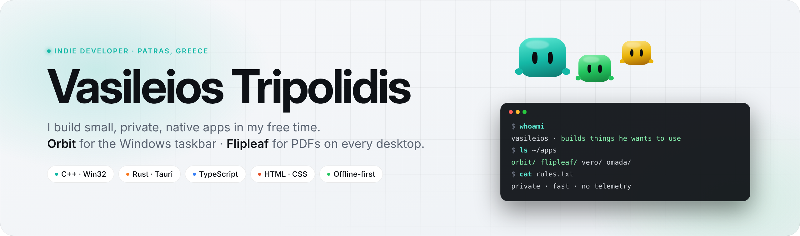
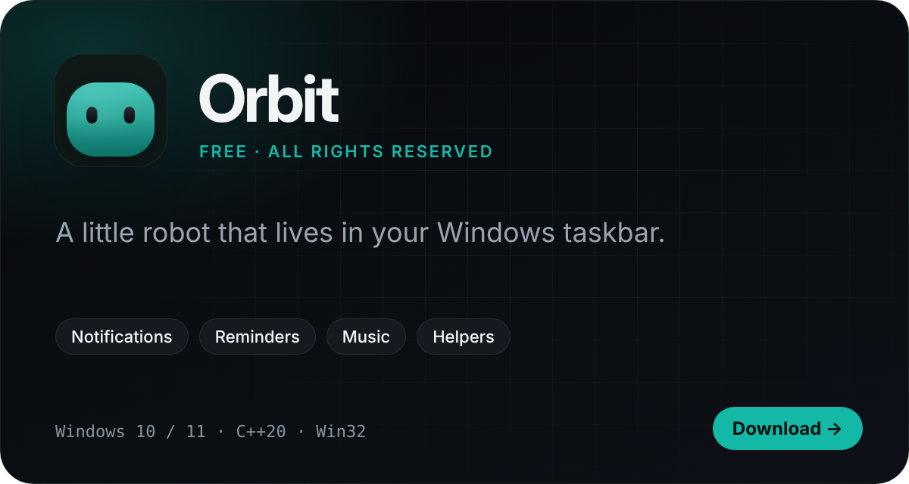
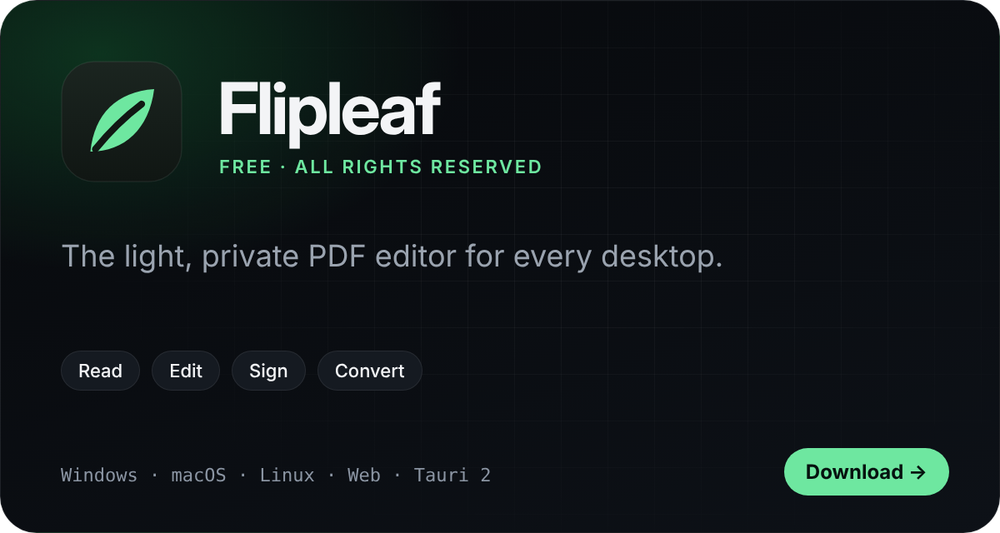

<picture>
  <source media="(prefers-color-scheme: dark)" srcset="assets/hero-dark.png">
  
</picture>

  &nbsp;
  

 

## Featured

<table>
  <tr>
    <td width="50%"></td>
    <td width="50%"></td>
  </tr>
  <tr>
    <td><b>Orbit</b> catches every notification, keeps your reminders and notes, plays your music and brings helpers for your finances and your windows. One native <code>.exe</code>, no runtimes.  <a href="https://github.com/vasileiostripolidis/Orbit/releases/latest/download/Orbit.exe"><b>Download for Windows →</b></a></td>
    <td><b>Flipleaf</b> reads, edits, signs, organizes, converts and protects PDFs. Small, offline, no telemetry, on Windows, macOS, Linux and the web.  <a href="https://github.com/vasileiostripolidis/flipleaf/releases/latest"><b>Download →</b></a></td>
  </tr>
</table>

## More projects

| Project | What it is | Built with |
|:--|:--|:--|
| [**Vero**](https://github.com/vasileiostripolidis/Vero) | Landing page for an order-taking app | HTML · CSS |
| [**Portfolio**](https://github.com/vasileiostripolidis/Vasileios_Portfolio) | My personal website | HTML · CSS |

## How I build

- **Native and light.** Apps that start instantly and use what the system already has, instead of bundling a browser.
- **Private by default.** No accounts, no telemetry, no ads. Your data stays on your device.
- **Free to use.** The apps are free; the source code is private and all rights are reserved.

 

---

### 🇬🇷 Ελληνικά

Είμαι ο Βασίλειος Τριπολίδης, από την Πάτρα. Στον ελεύθερο χρόνο μου φτιάχνω μικρές, γρήγορες εφαρμογές που σέβονται τα δεδομένα σου: τον **[Orbit](https://github.com/vasileiostripolidis/Orbit)**, ένα ρομποτάκι για τη γραμμή εργασιών των Windows, και το **[Flipleaf](https://github.com/vasileiostripolidis/flipleaf)**, έναν ελαφρύ επεξεργαστή PDF για κάθε υπολογιστή. Είναι δωρεάν· ο κώδικας είναι ιδιωτικός.

Επικοινωνία: [vasileios.tripolidis@gmail.com](mailto:vasileios.tripolidis@gmail.com)
